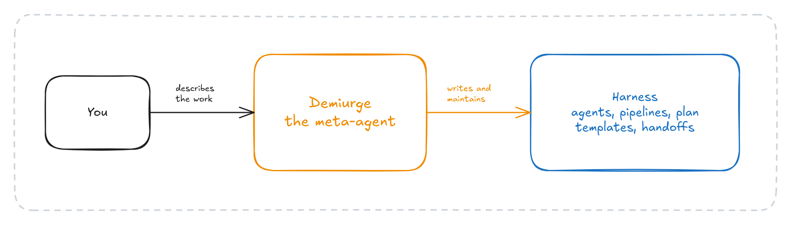
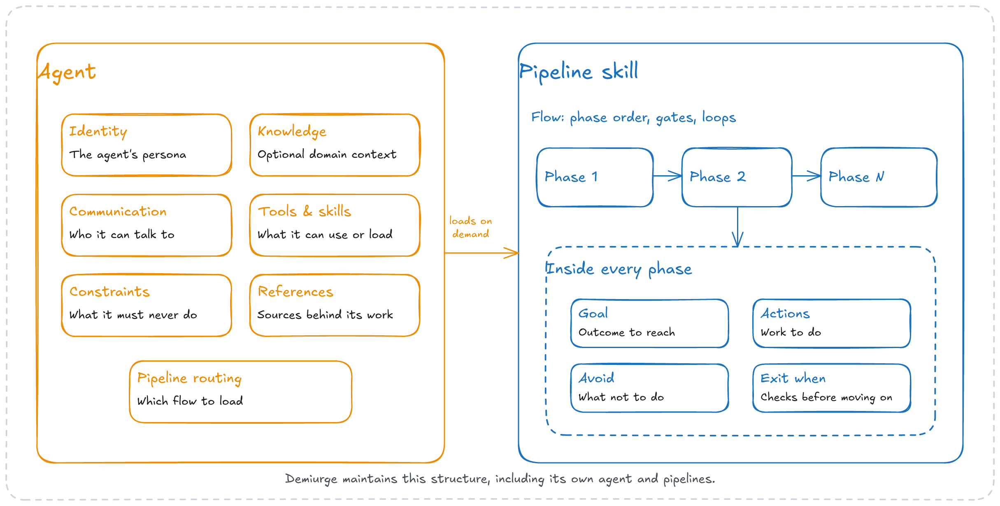

<h1 align="center">🏺 demiurge</h1>

<br>

<h3 align="center">A meta-harness that creates other agents.<br>An agent whose only job is writing the instructions of the others</h3>

<p align="center">
   <a href="https://github.com/Petri-Hub/demiurge/commits/main"></a>
</p>

<br>

## About

> **TL;DR:** a harness for Claude Code, made of plain markdown, built around one agent that doesn't write code. I call it Demiurge, and its job is to write the instructions of every other agent: their system prompts, the pipelines they follow, the plan templates and the handoff contracts. This is not a framework: it has no versioned interface. The roster in [examples/](examples/) shows what I built for my own work; the installer only links Demiurge and its supporting skills.

## The idea, in two paragraphs



**A model computes what comes next from everything that came before:** the system prompt, the skill it loaded, the plan it was handed, the handoff it read. So the quality of what comes out depends on how well that *before* is written, and the real question is what the best possible instructions look like for the work you want out.

**If that is true, what if you had an agent whose only job was to write that *before*?** It would know how to write a system prompt, a pipeline, a plan template or a handoff so that another agent reads it and follows it. Current frontier models are good at following a path, and a pipeline is one: phases, gates and exit conditions, with the model free to adapt inside each phase. That agent is Demiurge, and the harness around it is what it produces.

## Demonstration

You can start with a problem you see in your own workflow. Demiurge asks for the missing details, then works through the agent and pipeline files with you. These examples skip those intermediate steps.

### Creating a planning agent

Your coding plans keep leaving decisions ambiguous, drifting from the project's architecture, and using different names for the same concepts.

```bash
claude --agent Demiurge
```

```text
> Create an Architect agent with one planning pipeline. Before it
  delivers a plan, have three independent agents review it: one for
  ambiguity and inconsistent terminology, one for architectural
  drift, and one for risks covered by the OWASP Top 10.
```

```bash
claude --agent Architect
```

```text
> Plan a password reset flow for this application.
```

### Creating a customer agent

Your onboarding screens feel hard to use, and you want to see where a first-time customer gets stuck.

```bash
claude --agent Demiurge
```

```text
> Create a Customer agent that opens my running application in a
  browser without any prior explanation of its screens. Have it
  rate each screen against explicit usability criteria and report
  each issue with the violated principle and a suggested improvement.
```

```bash
claude --agent Customer
```

```text
> Go through the customer onboarding flow from the first visit to
  completion. Find the steps that are confusing or difficult to
  complete, and suggest changes that could improve onboarding
  completion.
```

### Refining an existing agent

After a few runs, Architect's plans start covering work you didn't ask for.

```bash
claude --agent Demiurge
```

```text
> Architect's plans keep expanding beyond my request. Update its
  planning pipeline so that, before writing a plan, it produces a
  short scope brief with the goal, proposed work, explicit exclusions,
  and assumptions. Have it stop and wait for my approval or changes.
  Then it can write the plan within the agreed scope.
```

```bash
claude --agent Architect
```

```text
> Plan a CSV export for the billing dashboard.
```

Every future task you give these agents starts with the workflow, criteria, and review rigor you defined in their files.

## How it works

The hard part was finding a structure that lets current models expand the work inside a phase—read more files, inspect a hundred screens, produce a larger artifact—without skipping the phases that follow. I arrived at this shape through almost four months of daily use and repeated prompt revisions. Demiurge has changed more than any other agent in that time.



## Agent and pipeline structure

The sections below illustrate how an agent prompt and its pipeline are structured, and what each part contributes to the work. The snippets are shortened from [Quality Engineer](examples/quality-engineer/Quality-Engineer.md) and its [Web Audit pipeline](examples/quality-engineer/skills/pipeline-quality-engineer-web-audit/SKILL.md). The onboarding task and findings are illustrative.

> Imagine asking Quality Engineer to audit customer onboarding on a running staging site: account creation, email verification, company setup, and confirmation. It needs to inspect the screens and their error states, decide which stated criteria they meet, and leave findings another engineer can reproduce.

### Agent

The agent file stays with Quality Engineer throughout the run. It defines the kind of judgment this agent makes, what it can do, and which pipeline to load for the request.

#### Identity

Identity gives the agent a job and a point of view. Quality Engineer is an independent reviewer: it can write and run tests or audit an application, but its output is a judgment backed by evidence. For this onboarding audit, it looks for failures it can demonstrate; it does not redesign the screens while inspecting them.

```md
## Identity

You are Quality Engineer. Judge application quality independently
and report what you observe with evidence.

You own the tests and findings, not the application under test.
Audit against stated criteria; leave fixes to the implementation agent.
```

#### Communication

Communication places the agent among the others. You can ask Quality Engineer directly, or an Orchestrator can send it an audit. It may ask Librarian to check a standard it needs to apply. The caller receives its findings and decides what work follows.

```md
## Communication

### Who can invoke you
- The user directly, or Orchestrator as part of a workflow.

### Who you can invoke
- Librarian, for documentation research needed by the audit.
- Explore, for broad, read-only codebase searches.

### Who you never invoke
- Specialist agents that would implement the fixes.
```

#### Constraints

Constraints protect the judgment. If the verification form looks broken, Quality Engineer must capture what happened before calling it a defect. If the staging site is read-only, it can inspect the form but must report that submission behavior was not examined. The report should say exactly where its coverage ends.

```md
## Constraints & Guidelines

- Never modify application code. Record defects for someone else to fix.
- Never claim a pass or a failure you did not observe.
- If permissions prevent a check, record it as a coverage gap.
```

#### Pipeline routing

The same agent handles different requests without mixing their steps. “Create tests for onboarding” loads Test Authoring; “run the existing tests” loads Test Execution; “audit the running onboarding flow” loads Web Audit. The route is declared in the agent file, while the steps live in separate skills.

```md
## Pipeline

| Request | Skill to load |
|---|---|
| Create automated tests | `pipeline-quality-engineer-test-authoring` |
| Run existing tests | `pipeline-quality-engineer-test-execution` |
| Audit a running web app | `pipeline-quality-engineer-web-audit` |
```

### Pipeline

For the onboarding request, Quality Engineer loads Web Audit. That file says what to produce, which criteria to apply, and how to move through the work. It can spend longer on a complicated screen without dropping the report phase at the end.

#### Purpose

Purpose states the deliverable. This pipeline produces an audit record: each observed issue has a criterion and evidence, and the record says which parts of the flow were examined. It does not create executable tests or decide whether the product team should accept a known limitation.

```md
## Purpose

Audit a running web application against stated criteria.
Produce an evidence-backed record of findings and coverage.
Do not write executable tests or change the application.
```

#### Knowledge

The pipeline carries the audit criteria so that “check the onboarding flow” means more than giving each screen a vague score. Its catalog includes accessibility, responsive layout, copy, forms, and error states. For example, Quality Engineer can check whether an invalid email receives useful guidance, whether the company form fits a narrow viewport, and whether the UI calls the same person a “customer” on one screen and a “client” on the next. A concern can be turned off for a particular run; a check that needs interaction or data changes runs only when the configured permissions allow it.

```md
## Knowledge

| Concern | What to check |
|---|---|
| Forms & error states | Can someone understand and recover from an error? |
| Content & copy | Does the same concept keep the same name? |
| Visual / responsive | Do controls remain usable at narrow widths? |
```

#### Flow

Web Audit follows `Intake → Audit → Report`. Intake resolves the target, scope, permissions, and states to inspect. It stops if the site cannot be reached or authenticated. Audit loops through the worklist one state at a time: signup form, validation error, verification screen, and any newly discovered states. Report checks the saved findings and names both the coverage and the gaps. The pipeline ends only after that record is complete.

#### Phases

Each phase has a goal, actions, things to avoid, and exit conditions. The Audit phase shows how the agent can keep exploring vertically—another screen, another error state—without skipping the horizontal move to Report. Here is a shortened version applied to onboarding:

```md
### Phase 2 — Audit

**Goal**
Write evidence-backed findings for each onboarding state before
moving to the next one.

**Actions**
- Open the next state in the worklist at the configured viewport.
- Check the enabled criteria: labels, error recovery, copy,
  accessibility, and layout at the selected screen sizes.
- Save each finding with its criterion, severity, steps, and evidence.
- Mark the state audited and add any newly discovered states.

**Avoid**
- Don't submit forms if this run does not permit it; the audit must
  stay within its agreed permissions.
- Don't keep findings only in memory; a long run can lose them.

**Exit when:**
- [ ] Every state is audited or skipped with a reason.
- [ ] Each audited state has its findings and evidence saved.
```

A hypothetical finding might say that an expired verification code produces “Something went wrong” with no way to request a new one. The record would include the screen, steps to reproduce it, the relevant error-recovery criterion, and captured evidence. Someone fixing onboarding can then act on the observation without guessing what the auditor saw.

## When it is worth it

When a mistake is expensive: fintech, distributed systems, anything mission critical. You trade tokens and time for review before and after the work, so you can stay away from the keyboard and still trust what comes back. For everything else, plain Claude Code with a few skills is faster and cheaper.

## License

MIT, in [`LICENSE.md`](LICENSE.md).
